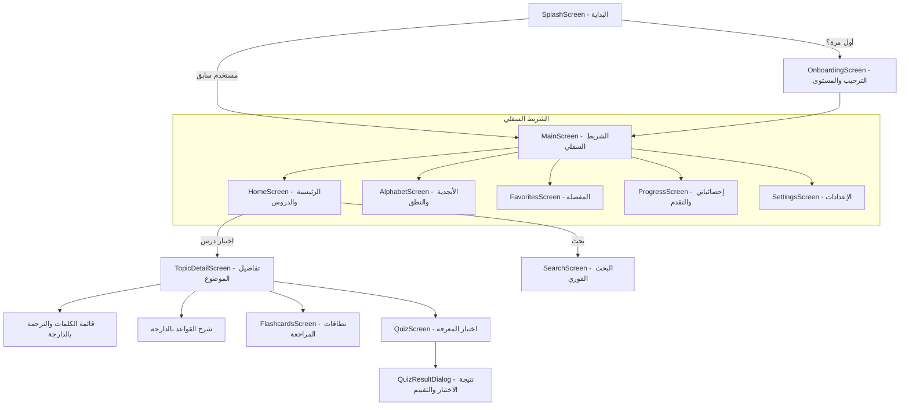

# خريطة شاشات التطبيق (SCREEN_MAP.md)

## 1. الهيكلية العامة للشاشات (Screen Hierarchy)

## 2. تفاصيل ومكونات كل شاشة (Screens Specifications)

### 1. `SplashScreen`
- **العنوان**: "تعلم الألمانية بالدارجة"
- **المكونات**: الشعار مع أنيميشن ناعم، مؤشر تحميل خفيف.
- **المنطق**: فحص هل أكمل المستخدم الـ Onboarding عبر DataStore، ثم التوجيه التلقائي.

### 2. `OnboardingScreen`
- **الصفحات**:
  1. *مرحباً بك*: تعلم الألمانية بسهولة بلسان مغربي مفهوم.
  2. *تعلم بلا إنترنت*: جميع الدروس والمفردات متاحة عندك في الجيب بدون نت.
  3. *حدد مستواك وهدفك*: مبتدئ تماماً، متوسط، أو مراجعة سريعة (5، 10، أو 20 كلمة في اليوم).

### 3. `HomeScreen` (الرئيسية)
- **المكونات**:
  - بطاقة اليوم (كلمة اليوم بالألمانية والدارجة مع زر النطق).
  - شريط البحث السريع.
  - أقسام التصنيفات (Chips/Tabs):
    - **الأساسيات (Basics)**: الحروف، الأرقام، الألوان، أفراد العائلة، التحيات.
    - **الحياة اليومية (Daily Life)**: الأكل والشرب، الملابس، المنزل، الروتين اليومي.
    - **القواعد (Grammar)**: أدوات التعريف والتنكير، الأفعال، الضمائر، حروف الجر.
    - **المواقف والتواصل (Conversations)**: في المطار، التسوق، عند الطبيب، الأسئلة الشائعة.
  - شبكة البطاقات (Cards Grid) بتصميم عصري وأيقونات جميلة وعداد الكلمات لكل درس.

### 4. `AlphabetScreen` (الأبجدية)
- **المكونات**: شبكة الحروف الـ 30 (بما فيها الحروف الخاصة: Ä, Ö, Ü, ß).
- **عند الضغط**: كارت مكبر يعرض اسم الحرف، طريقة النطق بالألمانية، وأمثلة على كلمات ألمانية مع ترجمتها بالدارجة وزر الاستماع.

### 5. `TopicDetailScreen` (صفحة الدرس المختار)
- **شريط علوي**: اسم الدرس، زر المفضلة العام، وزر المشاركة.
- **تبويبات علوية (Tabs)**:
  - **الكلمات (Wörter)**: قائمة الكلمات مع الترجمة بالدارجة، نوع الكلمة (مذكر der / مؤنث die / محايد das)، وزر الصوت والمفضلة.
  - **القواعد (Grammatik)**: شرح مبسط ومباشر بالدارجة المغربية لقاعدة الدرس.
- **أزرار سفلية تفاعلية**:
  - زر تشغيل البطاقات (Flashcards).
  - زر بدء الكويز (Quiz).

### 6. `FlashcardsScreen` (البطاقات التفاعلية)
- **المكونات**:
  - بطاقة مركزية تقلب بتأثير 3D (Flip Animation) عند اللمس.
  - الوجه الأول: الكلمة الألمانية مع النطق ونوع الأداة.
  - الوجه الثاني: المعنى بالدارجة مع مثال توضيحي.
  - أزرار التحكم: (عرفتها ✅ / مازال كنعقل عليها 🔄)، مع عداد التقدم (مثلاً 5 / 20).

### 7. `QuizScreen` (اختبار الكويز)
- **المكونات**:
  - شريط تقدم الاختبار.
  - السؤال: إما نص ألماني يطلب اختيار معناه بالدارجة، أو صوت استماع واختيار الكلمة الصحيحة.
  - 4 اختيارات واضحة مع إضاءة خضراء عند الإجابة الصحيحة وحمراء عند الخطأ وتأثير اهتزازي (Haptic Feedback).
  - ملخص النتيجة مع نسبة النجاح ونقاط الخبرة المكتسبة.

### 8. `FavoritesScreen` (المفضلة)
- الكلمات والعبارات التي حفظها المستخدم، مع إمكانية مراجعتها كقائمة أو إجراء كويز مخصص لها فقط.

### 9. `ProgressScreen` (إحصائياتي)
- عدد الأيام المتتالية (Streak).
- إجمالي الكلمات المكتسبة.
- معدل الإجابات الصحيحة في الكويزات.
- رسوم بيانية توضح نشاط المستخدم في الأسبوع الحالي.

### 10. `SettingsScreen` (الإعدادات)
- تفعيل / تعطيل الوضع المظلم (Dark Mode).
- سرعة نطق الصوت (عادي / بطيء لتسهيل الفهم).
- تفعيل التذكيرات اليومية.
- مسح سجل التقدم للبدء من جديد.
- معلومات عن التطبيق والإصدار.
